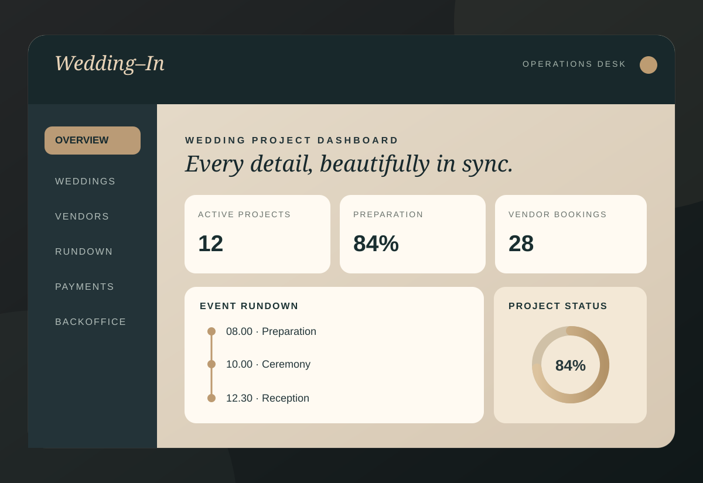

# Wedding-In

**Wedding Organizer ERP · Hybrid Project Operations & Financial Backoffice**

Wedding-In brings the workflow of a wedding organizer into one modular web application: client and project records, quotations, vendor coordination, preparation, event-day execution, payments, and accounting-oriented backoffice.



**[Live interactive demo](https://febriantrip.github.io/wedding-in/)** · **[Portfolio case study](https://febriantrip.github.io/#work)**

> **Portfolio/demo project.** The publicly hosted version runs on synthetic browser-side demo data. It is not connected to a production wedding database, does not process real payments, and cannot register real passkeys. The local full-stack application uses an Express API and MySQL.

## Highlights

| Area | Capabilities |
| --- | --- |
| Wedding projects | Client records, project overview, event dates, budget and profitability |
| Commercial | Master pricing, event types, services, packages, quotations and status workflow |
| Vendor management | Vendor booking, obligations, payment progress and coordination |
| Client payments | Payment plans, invoices, installments and receivables |
| Preparation | Calendar, Gantt timeline, checklist, tasks and meeting notes |
| Event execution | Editable rundown, protected master template, monitoring and issue tracking |
| Backoffice | Account/bank register, transactions, journal validation, finance reports |
| Governance | Change orders, project closing controls, basic approvals and audit trail |

See [Modules & flows](docs/MODULES.md) for what each workspace is designed to demonstrate.

## Technology

- **Frontend:** React 19, TypeScript, Vite 6, Recharts, Lucide, Motion.
- **Backend:** Node.js, Express, Zod, cookie-based JWT sessions.
- **Database:** MySQL/MariaDB, additive SQL migrations and demo seed scripts.
- **Security foundations:** bcrypt password hashing, WebAuthn/passkey endpoints for local full-stack mode, server-side access checks.
- **Verification:** TypeScript checks and Node test suite (`npm test`).

## Run locally

### 1. Interactive demo — no database required

```bash
npm ci
npm run dev:web
```

Open `http://localhost:5173` and select the demo mode on the login screen. Demo edits remain in browser storage; they are not written to MySQL. A public-style static build can be generated with:

```bash
VITE_PUBLIC_DEMO=true npx vite build --base=/wedding-in/
```

### 2. Full-stack local application — MySQL required

1. Install Node.js and start MySQL/MariaDB.
2. Create a dedicated empty database and an application DB user with privileges only for that database.
3. Copy `.env.example` to `.env`, then fill `DB_*`, a **random `JWT_SECRET` of at least 32 characters**, `ADMIN_EMAIL`, and a strong `ADMIN_PASSWORD` of at least 12 characters.
4. Run:

```bash
npm ci
npm run db:migrate
npm run db:seed
npm run dev
```

The Vite frontend normally runs on `http://localhost:5173` and the API on port `4000`. For API operation the `.env` values must be valid; never reuse demo credentials for a real deployment. Optional synthetic showcase seed: `npm run db:seed:showcase`.

For environment and hosting differences, read [Demo vs. Local API](docs/DEMO_MODE.md).

## Project structure

```text
src/
  components/      # React workspaces (commercial, projects, operations, backoffice)
  demo/            # Browser-side demo handlers and synthetic records
  api.ts           # Shared API/demo entry point
server/
  modules/         # Commercial, project, operations and backoffice API domains
  auth.ts          # Session protection
  passkeys.ts      # WebAuthn integration (local API)
sql/              # Versioned, additive MySQL migrations
scripts/          # Migrations, local demo seeds and verification helpers
tests/            # Unit and integrated-flow regression tests
docs/             # Scope, architecture and public demo guidance
```

## Verification

```bash
npm test
npm run build
```

The test suite covers money arithmetic, balanced accounting entries, project operations, quotation lifecycle, calendar/checklist behaviors, rundown templates, change orders, and demo API routes.

## Availability and data policy

- **GitHub source:** application source, migrations, scripts, tests and technical documentation.
- **Live Site:** a static, browser-side demo hosted at the portfolio's `/wedding-in/` path; it does not host this repository's Express API.
- **Not included:** `.env`, API secrets, real client/vendor databases, uploads, production credentials, machine-specific backups or `node_modules`.
- **Status:** evolving showcase project, **not** a claim of production certification or real-world financial compliance.

See [Architecture](docs/ARCHITECTURE.md) and [Security & local setup](docs/DEMO_MODE.md).

